# Ghosh

A local desktop workspace for infrastructure and automation, built with Rust,
Tauri and React for macOS 14+ Apple Silicon. The UI uses Nightfly Default colors,
a compact monospace layout, commands and keyboard-operated review dialogs.

**Development status:** workspace persistence, node inventory editing, a file-based
SSH key library, identity migration, jobs, approval infrastructure and real local
PTY terminals, direct managed SSH terminals and Playbook/Script authoring and execution are working.
The approved [implementation plan](docs/IMPLEMENTATION_PLAN_UI_FUNCTIONALITY.md)
is in progress. Native check/apply scenarios and Shell/Python/Deno scripts run locally or over SSH. Ansible and the other service screens are still being implemented. Unavailable actions explain
their status; prototype screenshots are never presented as working native features.

The approved [operational workflow supplement](docs/IMPLEMENTATION_PLAN_OPERATIONAL_WORKFLOWS.md)
addresses the reported SSH/workspace gaps, existing Ansible playbooks, certificate
timers, live monitoring and ComfyUI recipes (MiniMax H3, Wan 2.2, LTX 2.3, LoRA imports).
Workspace restoration, cleanable history and local approval defaults are implemented.
The remaining workflow sections describe planned work. See the current [feature checklist](docs/FEATURE_STATUS.md).

## Screenshots

These are actual native app captures, not Base44 mockups. Screenshots show public
metadata for a disposable identity or an explicitly selected existing key; no private
key material is shown.

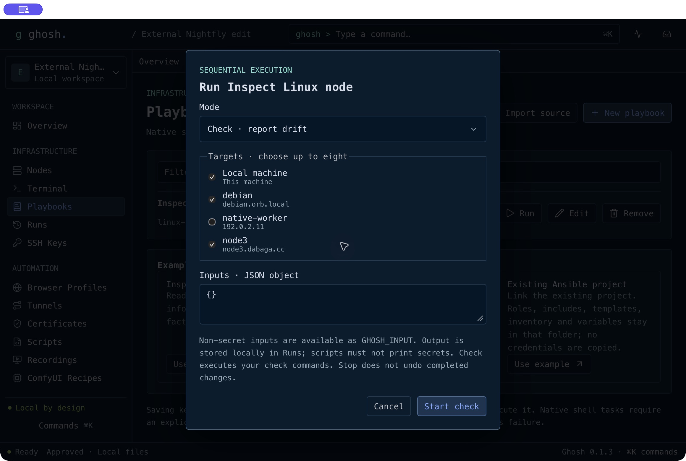

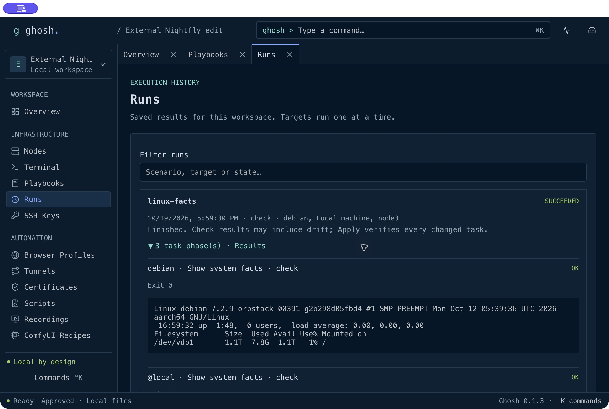

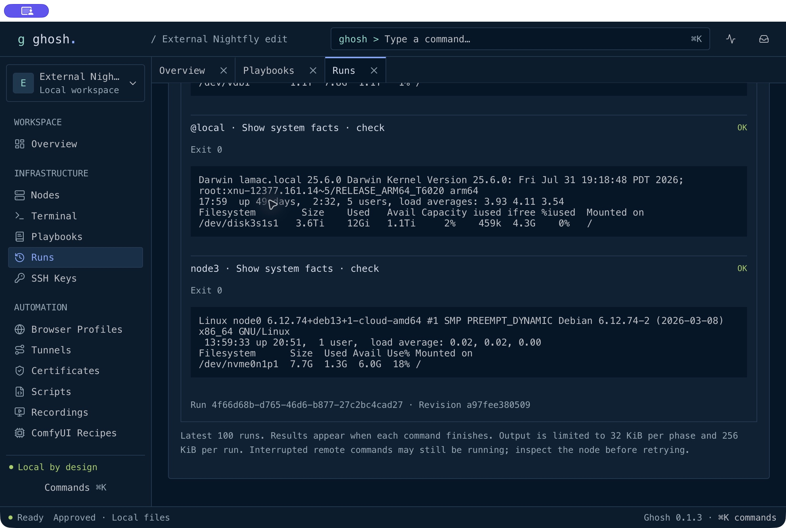

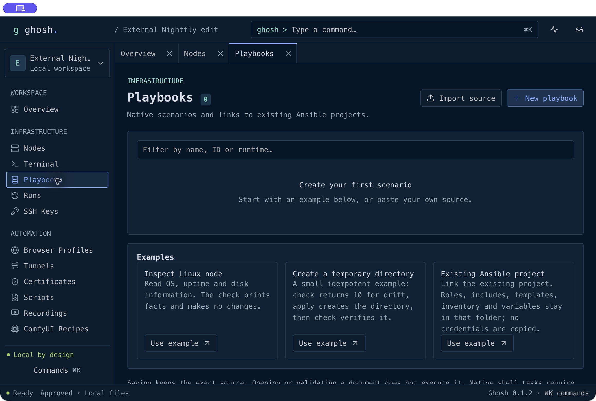

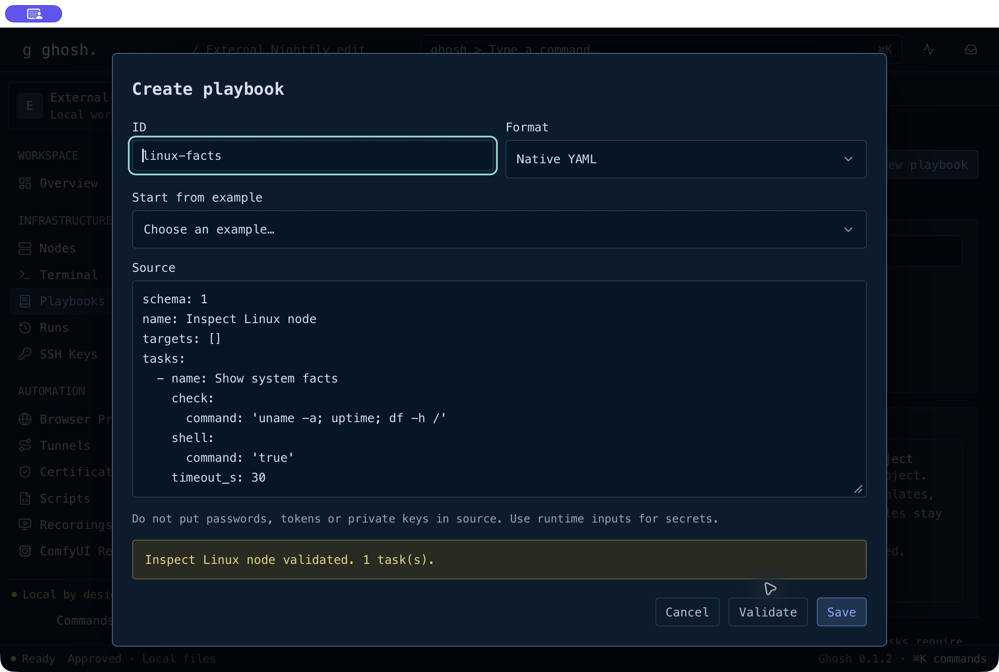

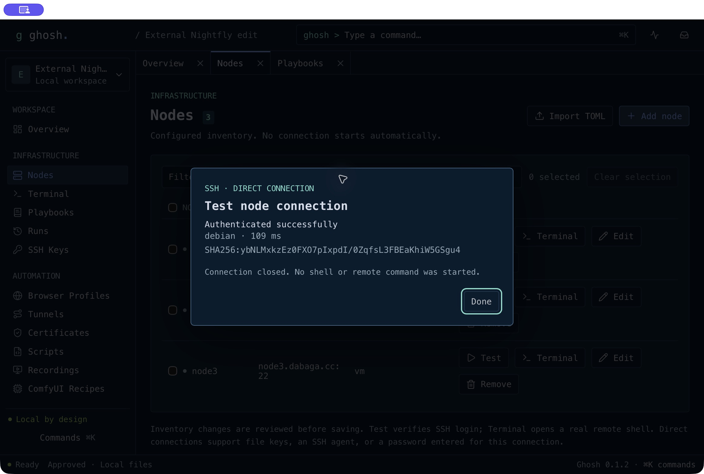

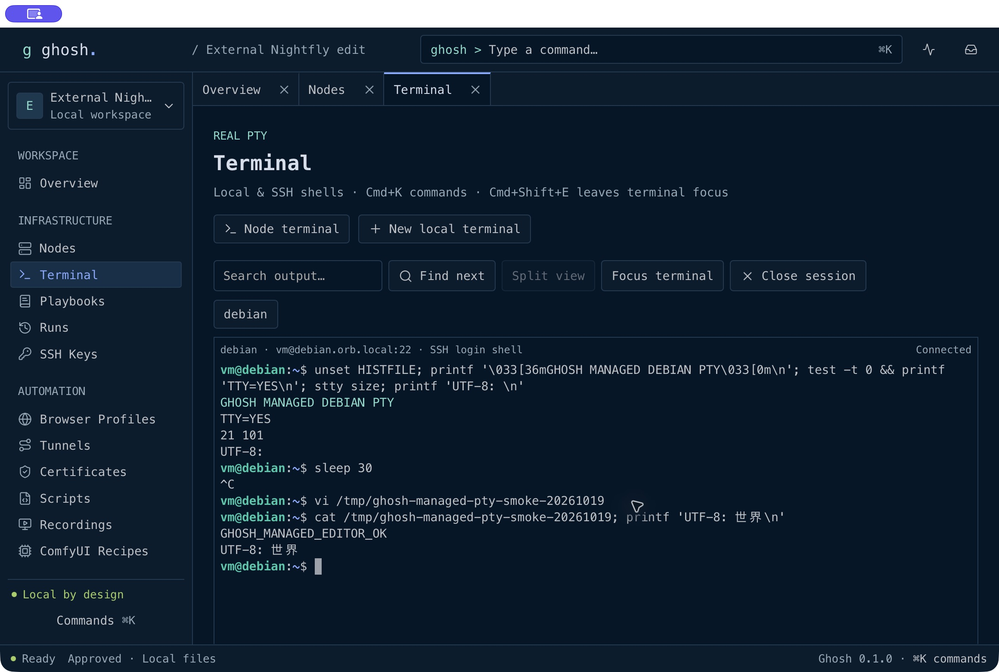

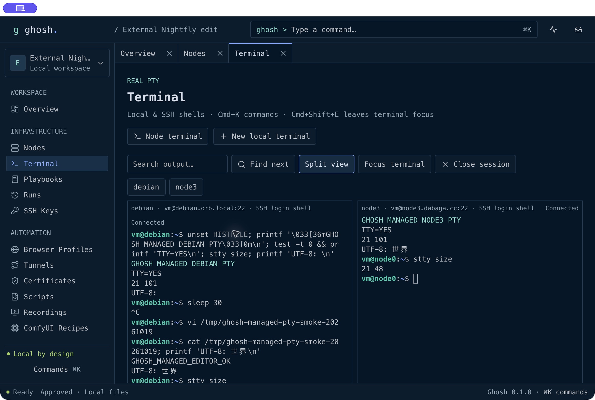

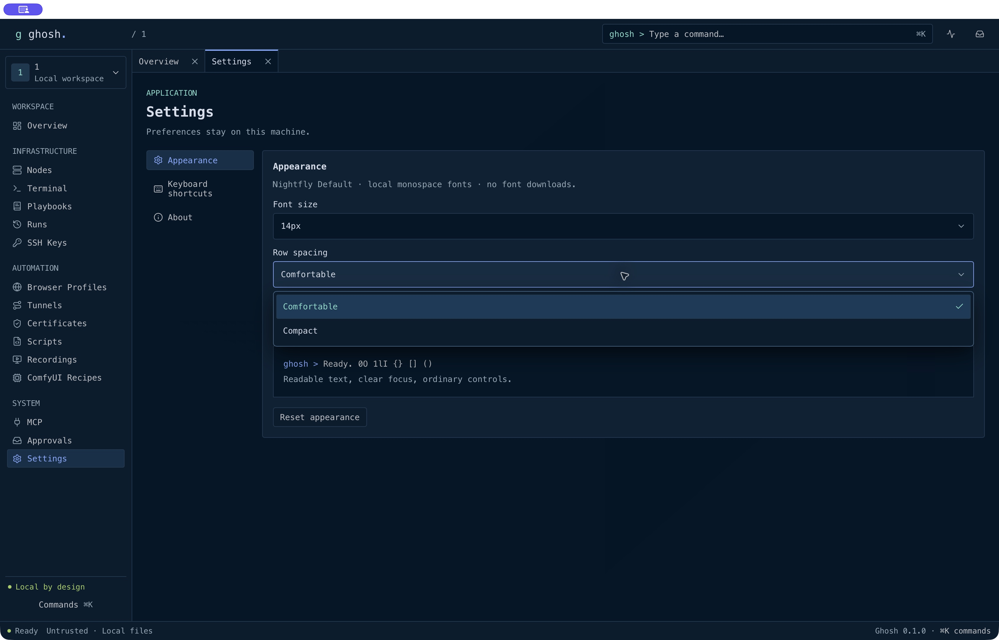

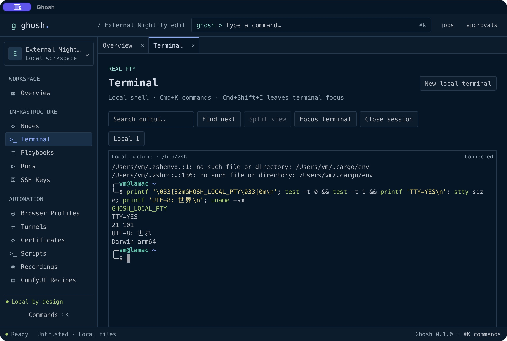

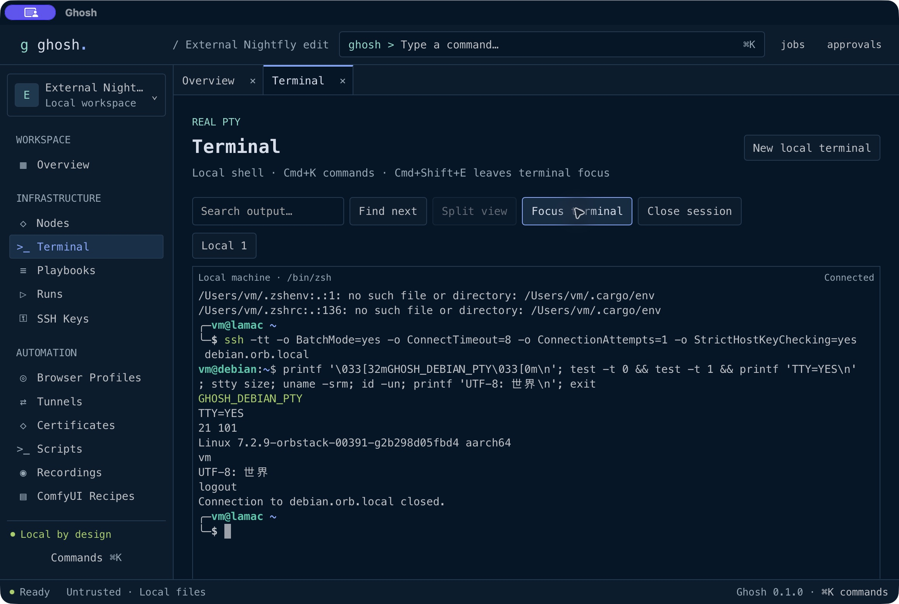

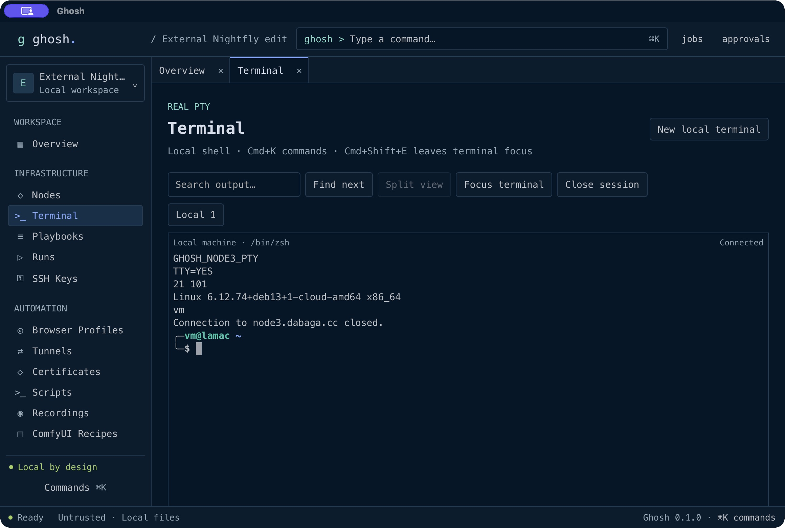

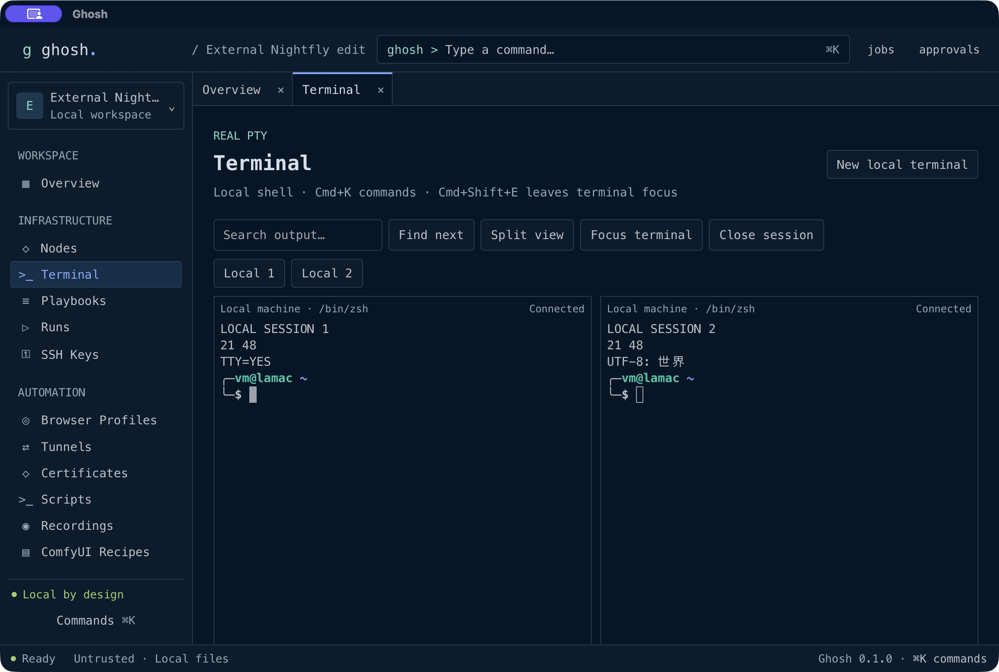

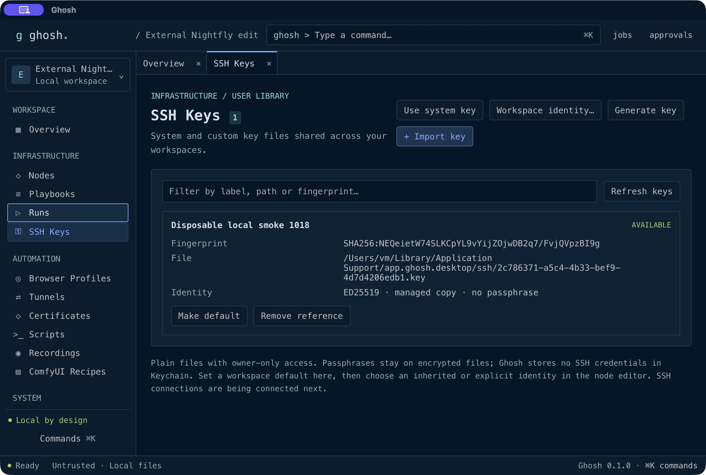

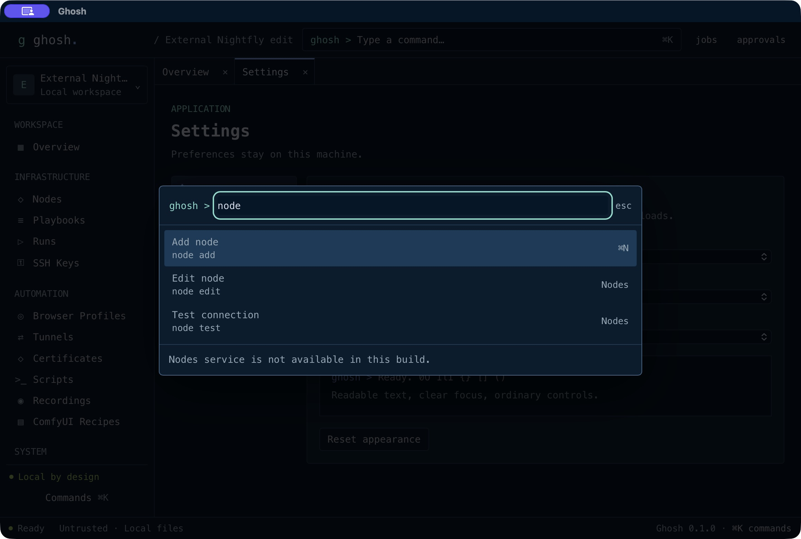

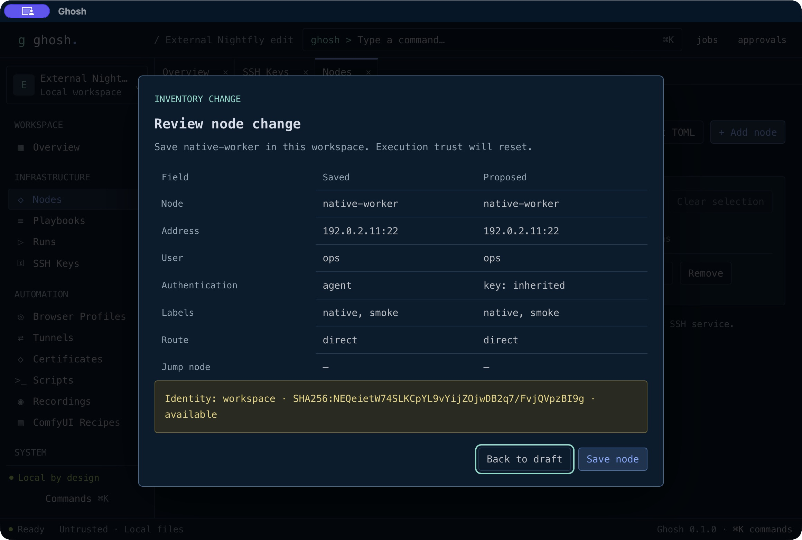

More native captures are in [UI evidence](docs/evidence/ui-shell/README.md).
The separate [Base44 reference inventory](docs/base44/reference-app/INTERACTION_INVENTORY.md)
records the design target and explicitly identifies simulated interactions.

## Run

Install Xcode Command Line Tools, Rust 1.96.0 through rustup, and Node.js 24+
with npm. The checked-in toolchain and dependency lockfiles are authoritative.
On Linux x86_64, the current build target is Ubuntu 24.04 with GTK 3,
WebKitGTK 4.1, OpenSSL and the Tauri development dependencies listed in
[the workflow](.github/workflows/ci.yml). Install `/bin/bash` for the local terminal.
Linux is an early build target; desktop interaction acceptance is pending.
Linux CI is temporarily disabled after the v0.1.2 checks failed. Its job remains
commented out in the workflow; tagged builds currently produce macOS artifacts only.

```sh
npm ci
npm run tauri dev
```

Build an arm64 application bundle locally:

```sh
MACOSX_DEPLOYMENT_TARGET=14.0 CARGO_BUILD_JOBS=1 npm run tauri build -- --target aarch64-apple-darwin --bundles app
open target/aarch64-apple-darwin/release/bundle/macos/Ghosh.app
```

The bundle is for local development; distribution signing and notarization are
not configured. The manifest display name can change without moving the package.
Use **Open workspace** to switch packages. Finder document-open requests use the
same validation and unsaved-change confirmation.

At startup Ghosh restores the last workspace; an explicit Finder request takes priority.
Use the workspace switcher or `workspace recent` to search/open recent packages,
create/open/close a workspace, remove an entry or **Clear history**. Removing history
never deletes workspace files. Closing a workspace prevents automatic restoration
until another one is opened. Missing or locked packages show a recovery error with
Open/New/history still available. History is stored locally in `workspaces.json`;
legacy `recent.json` is migrated automatically.

## Use the app

1. Choose **Create workspace**, or press **Cmd+O** to open a `.ghosh` directory
   package. Finder opens use the same validation and unsaved-change guards.
2. Press **Cmd+K** (also **Cmd+Shift+P**) to search commands. Use arrows, Return,
   Tab/Shift+Tab and Escape to operate menus and dialogs. Commands currently
   accept the shown syntax, such as `key system`, `key generate` and `node add`;
   arbitrary arguments are not accepted yet.
3. In **SSH Keys**, use an existing current-user key file or import a custom key
   by reference or managed copy. Review its public fingerprint before registering.
   `key generate` creates an unencrypted Ed25519 key only after explicit review.
   Managed files are 0600 in a 0700 directory; no SSH key/passphrase goes to Keychain.
4. **Workspace identity…** selects a workspace default or inheritance from the
   global default. The explicit review migrates schema 1 to schema 2, retaining a
   manifest recovery copy. It does not export legacy Keychain identities.
5. In **Nodes**, add/edit/import one TOML definition, review the proposed change,
   and save. In schema 2, choose SSH agent, per-connection password or file key and an inherited/explicit
   library identity. Saving inventory never connects to a host.
6. Local workspaces are approved by default. To verify a direct node connection,
   use **Test** in Nodes: it connects immediately and then closes the connection.
   **Terminal** in the node row opens a managed remote shell immediately.
   `node test` / `node terminal` in Cmd+K offer a node picker, then **Connect**.
   A password field appears only when the selected authentication requires it.
7. Press **Cmd+K**, enter `terminal open`, then review **Open shell** to start
   `/bin/zsh` in your home directory. **New local terminal** creates another
   independent session. Up to eight sessions can stay open; **Split view** displays
   the selected session alongside another. See terminal instructions below.
8. Use **Ctrl+Tab / Ctrl+Shift+Tab** between app tabs, **Cmd+F** for the current
   view’s search, **Cmd+S** to review a form, and **Cmd+W** to close a tab.
   **Cmd+1–9** selects the corresponding displayed tab; absent positions do nothing.
   **Cmd+[ / Cmd+]** cycles tabs. **Cmd+Shift+W** closes the workspace, preserving
   its files and asking about drafts or active terminals. **Cmd+Q** keeps normal quit behavior.
   **Cmd+Shift+E** focuses the selected navigation item. Settings controls font,
   density and zoom; preferences survive restart.

All selectors use themed menus with taller rows and inset arrows. Tab focuses a
selector; Return/Space or arrow keys open it. Arrows/Home/End move the highlight,
typing finds an option, Return commits and Escape cancels. Tab closes the menu
and moves focus. Long values are contained; menus fit within the viewport.

Effective file identity is **node override → workspace default → global default**.
A missing or changed explicit identity fails instead of silently falling back.
Removing a library reference retains the private file. Relink an external reference
only to a file with the same public fingerprint. Encrypted imports retain encryption;
the connection dialog asks for the passphrase without saving it. Never put private keys in a workspace.

## Use cases and availability

| Workflow | Current support |
| --- | --- |
| Maintain a portable homelab or GPU-node inventory | Create/open packages; add/edit/import/remove nodes; review changes and conflicts |
| Reuse SSH identities across workspaces | Existing system files, custom references/copies, Ed25519 generation, defaults and relinking |
| Verify access before operating on a node | Direct SSH Test/Terminal without a confirmation step; file keys, SSH agent or a per-connection password |
| Operate entirely from the keyboard | Command popup, navigation, tabs, scoped search/save and modal review |
| Inspect local workspace work and authorizations | Real jobs, approval inbox and revocable native grants; execution integration pending |
| Troubleshoot locally or on a remote node | Real local and managed SSH PTYs, xterm emulator, split/search and optional manual system SSH |
| Author a scenario or script | Playbooks/Scripts: New, paste source, examples, edit, validate, save and recoverable remove; YAML, Shell, Python and Deno |
| Run native scenarios and scripts | Select up to eight local/SSH targets; Check/Apply/verify, handlers, Stop and persistent per-node results |
| Run the existing Ansible project | Inert project links can be saved; real Ansible Runner execution remains pending |
| Manage browser profiles, routes, certificates or ComfyUI | Planned native services; current placeholder screens do not execute operations |
| Give an agent controlled MCP access | Planned, disabled by default; no running MCP server yet |

The authorized integration targets are `debian.orb.local` (OrbStack Linux ARM64)
and `node3.dabaga.cc` (Debian Linux x86-64). Both passed real SSH TTY checks **inside
the built Ghosh terminal** as `vm`, with strict host-key checking, on 2026-10-18.
The native local PTY also passed ANSI color, UTF-8, TTY sizing, split resizing,
Ctrl+C, full-screen vi editing/save/exit and alternate-screen restoration checks. These terminal tests used the normal system SSH client inside the local shell.
The separate managed SSH authentication service also passed on both hosts, in an
opt-in native integration test and through the earlier release app’s keyboard review flow.
Native UI authentication completed in 106 ms for Debian and 2,298 ms for node3
(single observations, not benchmarks). Both server keys matched existing trust records.
On 2026-10-19, managed SSH PTYs passed on both hosts: input, resize, acknowledged
output replay, ANSI/UTF-8, exit status and cleanup. SSH-agent authentication and
PTY also passed on node3 with a disposable agent and with an encrypted temporary
copy of the authorized file key. The original key was unchanged. Password
authentication is implemented but has not been exercised against a live target.
Persistent host enrollment, jumps, SFTP and a dedicated facts service remain pending.
The native release UI also passed managed split resizing to 21×48 on both nodes,
Unicode paste and ANSI output; Debian passed Ctrl+C and Vim edit/save/exit.
The 0.1.2 release UI passed immediate Test authentication on Debian and node3
without an approval step; both Terminals opened directly with input focused.
Only a disposable Debian `/tmp` editor file was written; no production
configuration changed or software was installed. Full results and remaining
gates are in [the task log](docs/TASK_LOG.md).

## Create scenarios and scripts

Open **Playbooks**, or run `playbook new` from Cmd+K. Choose **Use example** for
read-only Linux facts, an idempotent temporary directory, or a link to the existing
server-first-run Ansible project. Give it a safe ID, edit the YAML, choose
**Validate**, then **Save**. **Import source** lets you paste a document into the
same editor. **Edit** reopens the exact saved text, including comments. External
changes require workspace reload before another save. **Remove** retains a
recoverable `.removed` file in the same folder.

**Scripts** / `script new` provides Shell, Python and Deno examples. Deno is a useful
optional runtime for JavaScript/TypeScript on nodes; no precompiled server agent is
required. It is not installed automatically. Script validation currently checks
source bounds rather than interpreter syntax. Native YAML validation checks the
supported task structure; Ansible links validate paths without reading or copying
project files. These operations do not execute code.

Sources live in the configured `playbooks/` and `scripts/` folders and participate
in workspace revision/conflict detection. Saving never executes a source.

## Run and inspect results

1. Open **Playbooks**, save **Inspect Linux node**, then choose **Run**. Select
   **Check** and your Debian/node3 nodes (or **Local machine**); choose **Start check**.
2. **Check** runs each declared check command: exit 0 means satisfied, exit 10
   means drift; another exit fails that node. Check commands are executable code,
   so use read-only commands when that is the intended behavior.
3. **Apply** checks immediately before each change, runs the shell command only
   for drift, then checks again. Failed verification stops the node. Explicit
   retries recheck state; interrupted commands are never retried automatically.
   `creates`/`unless`, `changed_when` and deduplicated successful-node handlers work.
   A nonempty YAML `targets` list limits the node IDs selectable for execution.
4. In **Scripts**, choose **Run** to execute Shell, Python 3 or Deno. The runtime
   must already exist on the target; missing Python/Deno produces a run result.
   Deno reports its version and runs without prompts, project config, lock writes
   or dependency downloads, with only GHOSH_INPUT environment and hostname access.
   Network/file/subprocess permissions and installation recipes are future work.
5. Optional non-secret JSON object inputs arrive as the `GHOSH_INPUT` environment
   variable. There are no result bindings, artifacts or secret-input broker yet.
6. **Runs** shows saved phases, exit codes, bounded output and **Stop run**.
   Targets execute sequentially; only one automation run is active. Cmd+K `run plan`
   or `run apply` opens the first runnable native playbook's target form.

SSH connections start without approval dialogs. Only a necessary password or key
passphrase prompts, and neither is saved. Existing changed host keys still fail.
Workspace edits/switch/close are blocked during execution; externally edited
source is rejected before the next invocation. Stop reaps local process groups;
remote stop, timeout or transport loss means **Outcome unknown** because closing
an SSH channel cannot prove a remote process ended. Completed changes stay applied.
A run left active after an app crash is displayed as unknown and never replayed.

Reports live in the application-local `runs/` folder (0700, files 0600), scoped to
workspace ID. The UI shows the latest 100; retention cleanup is not implemented.
Results update after each command, rather than streaming every byte. Capture is
32 KiB per phase and 256 KiB per report while both streams continue to drain.
Literal string inputs are masked, but scripts must not print secrets: output is
persisted and arbitrary secrets cannot be reliably detected. Review output before
sharing. No production Ansible playbook, certificate, plugin or model operation
has run as part of acceptance.

## Test a node connection

Register a file key in **SSH Keys**, select it as the workspace default or node
override, and use a schema-2 node with **File key** authentication. Alternatively,
choose **SSH agent** or **Password (ask when connecting)**. **Test** and **Terminal**
in the node row connect immediately. Cmd+K commands first offer a node picker.
No separate SSH approval or fingerprint checkbox is shown. Encrypted keys and
password mode ask only for the credential needed for that connection.

As requested, unknown server keys are accepted for the current connection without
confirmation. The native service still rejects a changed key in existing known_hosts
and pins the exact key between its handshake and authentication. This increment
does not persist newly observed keys; existing host-trust files remain unchanged.

The service reads current-user `~/.ssh/known_hosts` and OrbStack's
`~/.orbstack/ssh/known_hosts` when present. The selected file key comes from Ghosh's
library. Agent mode uses an explicit socket or SSH_AUTH_SOCK, reviews the first
supported identity and uses only that identity. No fallback/forwarding occurs.
Passwords/passphrases are cleared after dispatch; SSH never uses Keychain.
System SSH configuration, ProxyCommand, jump hosts and keyboard-interactive are
not supported by managed connections. Existing RSA known-host
records negotiate RSA SHA-2 rather than enabling legacy SHA-1 signatures.

A review expires after two minutes and is single-use. Changes to workspace trust,
configuration or the key registry invalidate it. Authentication reconnects and checks
the exact reviewed server key again before resolving the private key natively.
Errors appear in the dialog and **Jobs**; **Retry connection** obtains a fresh ticket. A successful test
closes the session without opening a shell, gathering facts or changing remote files.

## Terminal and remote troubleshooting

Use **Nodes → Terminal**, **Terminal → Node terminal**, or `node terminal` in
Cmd+K. Choose the node, review its endpoint/identity/server key, then **Open SSH
terminal**. It opens alongside local sessions and uses the same resize, search,
split, paste and close controls. This requires no server-side Ghosh agent.

Open a workspace, run `terminal open` from the command popup, and confirm **Open
shell**. This starts a real login shell with your normal startup files, user
permissions, environment and SSH configuration. Workspace trust does not sandbox
this shell. A broken startup-file reference appears just as in another terminal;
fix it in your own shell configuration if needed.

To connect using your existing SSH setup, type one of these in the Ghosh terminal:

```sh
ssh -tt -o StrictHostKeyChecking=yes debian.orb.local
ssh -tt -o StrictHostKeyChecking=yes node3.dabaga.cc
```

These names are test targets, not bundled accounts or required infrastructure.
Use a host you administer and its existing verified host-key record. System SSH
controls its own key/agent selection; manual terminal SSH does not use Ghosh's library/defaults.
The tests used `BatchMode=yes`, `ConnectTimeout=8` and `ConnectionAttempts=1` to
fail promptly. No keys, passphrases or host-key trust are shipped in this repo.

Inside either local or remote shell:

```sh
printf '\033[32mGhosh PTY\033[0m\n'
test -t 0 && test -t 1 && printf 'TTY=YES\n'
stty size
uname -sm
printf 'UTF-8: 世界\n'
```

**Cmd+F** focuses terminal search; Return/Shift+Return find next/previous.
Tab through **Split view**, **Focus terminal**, **Close session** and the session
buttons; Space/Return activates them. **Cmd+Shift+E** leaves terminal input for
navigation. **Ctrl+C / Ctrl+D / Ctrl+Z** go to the terminal. **Cmd+K** remains
reserved for app commands. Use **Cmd+C / Cmd+V** for selection copy and paste.
Multiline or long paste opens a review dialog; paste is bounded to 32 KiB.

Changing app tabs preserves sessions. Closing the Terminal tab, switching the
workspace or closing the window prompts before terminating live shells. Ghosh
keeps 5,000 scrollback lines per emulator in memory and saves no transcript;
your shell and remote programs can maintain their own history. Sessions do not
resume after app quit.

If a local-network connection fails only in the app, check **System Settings →
Privacy & Security → Local Network** for Ghosh and verify the node is running.
The app declares its SSH/local-node usage in its macOS bundle. Our initial Debian
attempt failed with “No route to host”; the rebuilt app then connected successfully.
Minimum macOS 14 execution, remote reconnect/route loss and managed SSH cancellation
remain acceptance gates.

## Workspace behavior

- `ghosh.toml` and flat entity TOML files are revisioned together. Manifest edits
  preserve comments and unknown keys. Explicit save requires the loaded revision.
- Cooperating Ghosh processes lock both canonical package path and workspace ID.
  Copying an open package without changing its ID intentionally blocks a writer.
- Saves write/sync a sibling file, recheck the revision, atomically replace the
  manifest and sync the directory. Creation publishes a complete staged directory
  with no-replace rename. A crash can leave a hidden staging directory; it is never
  treated as a workspace or removed automatically.
- External edits invalidate execution reviews and block saving until validated reload.
  Native notifications are debounced; a bounded configuration revision probe every
  two seconds covers missed events. Invalid reload preserves the last valid view.
- Schemas 1 and 2 validate IDs, UTC timestamps, contained non-overlapping paths, node
  authentication/references, profile UUIDs and required approval configuration.
  Schema 2 adds opaque workspace/node file-key IDs and permits unchanged schema 1 nodes.
  Newer **manifest** schemas open read-only. Newer entity schemas are rejected.
  Other future entity fields are preserved but not activated or fully validated.
- Local workspaces are approved by default. **Pause operations** suspends managed
  actions until resumed (or reopened); reload preserves that pause. Approval alone
  executes nothing. SSH authentication still needs a separate single-use review. Private keys and passphrases are absent from package
  files and frontend key DTOs. Local terminal input/output naturally may contain
  sensitive text and is not recorded by Ghosh.
  Keychain adapters require an explicit trusted native-service context.
  Linux reports `SecretUnavailable` for legacy Keychain references; it never
  substitutes plaintext secret storage. The ordinary SSH file-key library is separate.
- Prefer local disks. Advisory locks and hash checks cannot provide distributed
  transactions or prevent an arbitrary editor writing inside the final check/rename
  interval. State/history and native browser data are not portable secret storage.

## Checks

Run these sequentially on an arm64 Mac:

```sh
cargo fmt --all -- --check
MACOSX_DEPLOYMENT_TARGET=14.0 CARGO_BUILD_JOBS=1 cargo clippy --workspace --all-targets --target aarch64-apple-darwin -- -D warnings
MACOSX_DEPLOYMENT_TARGET=14.0 CARGO_BUILD_JOBS=1 RUST_TEST_THREADS=1 cargo test --workspace --target aarch64-apple-darwin
cargo run --locked -p ghosh-core --example export_contracts -- --check
npm run build
npm run test:ui
```

Generated TypeScript and JSON Schemas are checked in. Regenerate with
`npm run contracts`; never edit them directly. JSON Schema describes the structural
projection; runtime validation also enforces cross-file references and policy.

The optional remote integration test authenticates, verifies existing host trust,
checks review replay rejection, exercises a real PTY and bounded command execution,
then executes the saved Linux facts scenario and checks its persistent report. It uses
a disposable workspace and your existing `~/.ssh/id_ed25519` (override with
`GHOSH_SMOKE_KEY`). Run only when authorized to access both named test hosts:

```sh
MACOSX_DEPLOYMENT_TARGET=14.0 CARGO_BUILD_JOBS=1 cargo test -p ghosh-desktop --lib --target aarch64-apple-darwin authorized_nodes_native_authentication -- --ignored --test-threads=1 --nocapture
```

The optional native Keychain test creates, reads and deletes a temporary item:

```sh
cargo test -p ghosh-desktop --lib --target aarch64-apple-darwin native_keychain_round_trip_and_cleanup -- --ignored --test-threads=1
```

It needs an unlocked user Keychain outside a filesystem-only sandbox. The default
suite skips it so CI does not open permission prompts. Local verification and
native smoke evidence are recorded in [the task log](docs/TASK_LOG.md).
CI runs **only when a `v*` tag is pushed**. It verifies the tag against all three
version manifests, then checks/builds macOS arm64. The Linux job is temporarily
commented out at the user's request; it does not run or upload artifacts.
Branch pushes and pull requests do not start it. Windows remains deferred.
Runner labels follow the [GitHub runner reference](https://docs.github.com/en/actions/reference/runners/github-hosted-runners).

## Tagged build artifacts

Open a completed tagged run in [GitHub Actions](https://github.com/gubnota/ghosh/actions).
Current artifacts contain a macOS `.app` archive, `SHA256SUMS` and license notices.
The local packaging script also supports Linux `.deb` and binary archives, but
Linux CI is disabled and no successful Linux artifact is claimed.
These are unsigned development builds;
macOS signing/notarization and Linux desktop acceptance remain pending. Linux
archives require system GTK/WebKitGTK libraries and are not standalone static builds.
The `.deb` declares runtime dependencies; install it on Ubuntu 24.04 with
`sudo apt install ./ghosh*.deb` after extracting the artifact.

To reproduce packaging on the corresponding native architecture:

```sh
npm ci
bash scripts/check.sh
bash scripts/build-release.sh v0.1.3
```

Output is under ignored `artifacts/`. Increment package.json (and lockfile),
Cargo workspace/package lock versions and tauri.conf.json together before a new tag.
Pushing a version tag starts the release checks; artifacts are uploaded only after
that platform passes. The commented Linux job includes headless native startup
checks for when Linux builds are re-enabled.

## Remote JavaScript and agents

The SSH design does not require a persistent precompiled Ghosh server agent.
Deno scripts now run locally or over authenticated SSH using an already installed
runtime; its version appears in the phase output. Ghosh uses bounded output and
explicit permissions and does not install Deno on nodes.
No `--allow-all` default: file/network/environment access must be scoped;
subprocess and FFI permission need separate review because they escape those limits.
Static imports also need pinned/vendored dependency controls. See
[Deno’s security model](https://docs.deno.com/runtime/fundamentals/security/).
Dependency acquisition, configurable script permissions and the separate local
embedded scripting API remain planned.

## Navigate

Start with [project context](docs/PROJECT_CONTEXT.md) and
[architecture index](docs/ARCHITECTURE_INDEX.md). The six compact memory documents
are maintained for future agents. The full target architecture and later services
are specifications, not claims of implemented behavior.

Licensed under [MIT](LICENSE-MIT) OR [Apache-2.0](LICENSE-APACHE).
