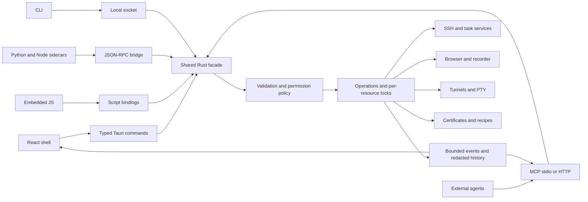
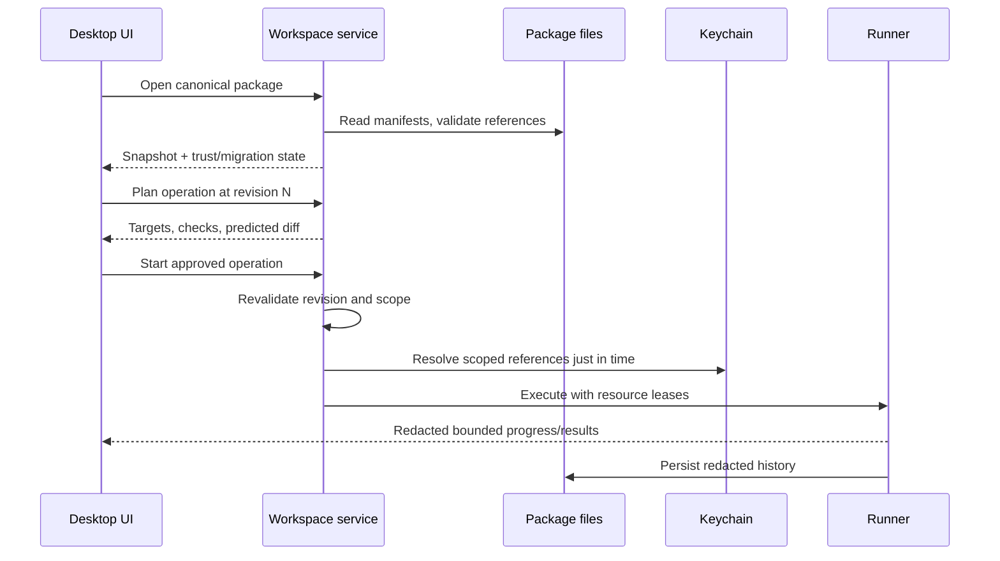
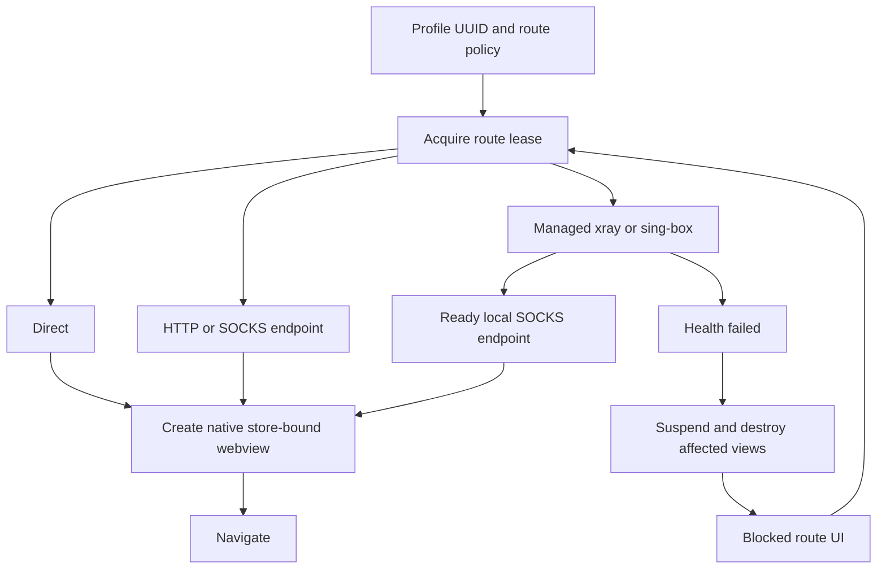

# Ghosh architecture

Date: 2026-10-18. Status: proposed architecture; source implementation awaits plan
approval. Repository baseline: initial commit bbac06a and `.gitignore` only.
License target: Apache-2.0 OR MIT. Primary target: macOS 14+, arm64.

## 1. Product and scope

Ghosh is a local desktop control plane for remote nodes and browser profiles.
An operator opens a `.ghosh` package, selects nodes and routes, previews changes,
runs repeatable automation, and inspects results in the same window. Browser,
terminal and script tabs share one tab strip. External agents use MCP; scripts
can call approved external MCP servers. All entry points share one Rust facade.

Source requirements: [user build prompt](ghosh-prompt.md), including normative
Appendices A/B. Deliverable 1 consists of this document and its detailed contracts:

- [Workspace schema v1](WORKSPACE_SCHEMA.md): A1–A8 with validation and corrections.
- [Scripting API v1](SCRIPTING_API.md): complete A9 plus runtime semantics.
- [MCP surface](MCP_SURFACE.md): tools, resources, prompts and enforcement.
- [Milestones](MILESTONES.md): M1–M8 acceptance gates.
- [M1 implementation plan](IMPLEMENTATION_PLAN_M1.md): bounded first source phase.
- [Base44 screen design request](BASE44_DESIGN_REQUEST.md): copy-ready design brief.

## 2. Proposed repository and crate layout

All paths below are planned, except `docs/` and the existing `.gitignore`.
Do not create empty future crates merely to make a diagram compile.

```text
ghosh/
  Cargo.toml / Cargo.lock / rust-toolchain.toml
  package.json / package-lock.json / tsconfig.json / vite.config.ts / index.html
  crates/
    ghosh-core/src/{workspace,contracts,tasks,policy,operations,events,secrets}/
    ghosh-ssh/src/{pool,known_hosts,transport,sftp,tasks}/
    ghosh-certs/src/{certbot,acme,deploy,verify,scheduler}/
    ghosh-term/src/{session,pty}/
    ghosh-webview/src/{profile,tabs,capabilities,platform/}/
    ghosh-tunnel/src/{route,supervisor,health,platform/}/
    ghosh-script/src/{api,permissions,runtimes,bridge}/
    ghosh-recorder/src/{capture,selectors,replay,export}/
    ghosh-comfy/src/{plan,apply,verify,export}/
    ghosh-mcp/src/{server,client,tools,resources,prompts}/
    ghosh-cli/src/
  src-tauri/
    src/{main.rs,lib.rs,services.rs,commands.rs,events.rs,platform/}
    capabilities/desktop.json / permissions/commands.toml
    tauri.conf.json / build.rs / Info.plist
  src/
    app/ features/ components/ terminal/ generated/ styles/
  tests/{fixtures,ssh,mcp,platform}/
  scripts/                         # build/type generation/check helpers
  .github/workflows/
  docs/                           # six compact memory files + detailed specs
```

`ghosh-core` holds portable contracts and engine/workspace behavior, not an
import of every service. The facade is a registry of injected trait-backed
capabilities. The desktop composition root constructs concrete implementations.
Core tests use fakes; domain services use injected transport/routing contracts.

| Module | Owns | Depends on |
| --- | --- | --- |
| core | workspace AST/model, task DAG, operation/event contracts, policy, service ports | portable libraries only |
| ssh | russh pool, host trust, channels, SFTP, remote task adapters | core |
| tunnel | xray/sing-box supervision, proxy route leases | core |
| webview | store UUIDs, tabs, page backend, data purge | core; platform bindings |
| term | PTY lifecycle, bounded byte streams, expect | core; portable-pty |
| certs | DNS-01 workflows, sync/reload/verify | core ports for secrets, SSH, routes |
| recorder | capture validation, step interpreter, export | core page and workspace ports |
| comfy | recipe planning, preflight, apply/export | core task/SSH/download ports |
| script | host bindings, runtime supervision, bridge | core facade only |
| mcp | protocol server/client and DTO adaptation | core facade; rmcp |
| src-tauri | service wiring, UI IPC, native lifecycle/approval | concrete service crates |
| CLI | argument parsing, local discovery, stdio shim | core local protocol; MCP adapter |
| React | navigation, editor, logs, terminal renderer | generated DTOs and typed IPC |

Adapters may not import `src-tauri`; core may not import adapter crates; frontend
may not create SSH/process/network sessions independently. Build tools own type
and JSON Schema generation. Each behavior owner maintains its unit tests.

## 3. Shared application API and operation model

`GhoshApi` is a cloneable handle to services, not a global mutable singleton.
Every invocation has `CallContext`: principal (human UI, script hash, MCP client),
workspace ID/revision, granted capabilities, operation ID, deadline and
CancellationToken. Business methods receive validated IDs/DTOs and return typed
results or `GhoshError`. Long work is scheduled off the UI thread.



Rust DTOs produce TypeScript through `ts-rs`; JSON Schemas through `schemars`.
UI commands are explicit domain methods, not an unrestricted invoke-anything
endpoint. A small set of request/response/event envelope types is shared across
Tauri and local IPC. Domain calls include workspace create/open/update, node
list/facts/exec, run plan/start/cancel, profile/page operations, cert operations,
recipes, terminals, scripts and MCP. Browser-only payloads cannot call these.

A long UI/local operation returns an OperationHandle with id and event cursor.
MCP keeps the originating tools/call alive, sending standard progress when a
progressToken was provided, then returns the final result; no invented async MCP
wire protocol. Events include operation.started/progress/finished, run.task_result,
log.line, workspace.changed/conflict, tunnel.health, cert.status, tab.updated,
approval.requested/resolved. Event envelope: schema, workspace_id, operation_id,
sequence, timestamp, kind, payload, trust. Stream gaps trigger cursor-based replay
or a snapshot. Terminal bytes use bounded binary channels, not one JSON per char.

Operational lifecycle: queued → awaiting_approval → running → completed/failed/
cancelled/outcome_unknown. Approval is before effects. Audit/history writes can
still occur for denied or dry-run requests. Only one mutating run per node holds
a write lease across tasks and handlers; read probes have bounded concurrency.
No database or resource lock is held while waiting for human approval.

Cancellation stops new work, asks cooperative remote jobs to stop, terminates
owned sidecar process groups, and escalates after a grace period. Dropping an SSH
channel alone does not prove the remote process stopped: disconnected mutations
become outcome_unknown and require a re-check before retry. Cleanup has a separate
bounded deadline and is audited. No automatic rollback guarantee across nodes.

## 4. Workspace lifecycle and storage

Canonicalize the package, validate schema and references without executing hooks,
then enter trusted/read-only state as appropriate. Unknown workspace scripts are
not executed on open. Autosave and watching follow compare-and-swap document
revisions. State is runtime-only and redacted; recent paths and grants live in
per-user application support, not a workspace-controlled permissions file.



Keychain `SecretStore` exposes scoped resolve/put/delete, with secret wrappers
excluded from Debug/Serialize. Certificate private material lives in protected
application support, referenced by certificate ID; no PEM in the workspace.
OS-managed browser sessions stay outside the package. Moving the package
preserves configuration, not local secrets, browser sessions or portable grants.

## 5. SSH and declarative execution

`ghosh-ssh` implements strict host key validation in russh's callback, including
workspace or system known_hosts and explicit enrollment. Each jump and final host
is independently verified. Pool key includes workspace, logical node, auth
identity, host pin version and route generation. Channels multiplex on healthy
connections; route/identity changes drain old leases rather than silently reuse.
The [russh Handler contract](https://docs.rs/russh/latest/russh/client/trait.Handler.html)
requires application-level host trust decisions.

Transport service opens direct TCP, HTTP CONNECT or SOCKS5 streams. VLESS is a
managed local proxy route. ProxyJump uses direct-tcpip channels recursively with
cycle/hop limits. Accepted SSH auth target uses existing/custom local key files,
memory-only passphrases/passwords or an explicitly selected local agent; agent
forwarding is disabled. [SSH_KEY_STORAGE.md](SSH_KEY_STORAGE.md) supersedes older
SSH Keychain examples; the current M1.1 parser still needs a planned amendment. SFTP writes stage on the target filesystem and atomically
rename; checksum and permissions are checked. Lack of an atomic rename extension
fails or requires a disclosed reviewed alternative; no partial overwrite claim.

Task flow is guard → read-only check → plan/diff → apply if drift → post-check →
notify. Built-in task adapters own OS-specific probes and safe argument handling.
Shell is explicitly shell syntax; all structured task fields use quoting or
transport-safe argument construction. Never interpolate untrusted facts into a
shell command without an explicit template/escaping contract.

Arbitrary user `check` commands cannot be proven read-only. External MCP check
mode only allows built-in verified probes or previously human-approved check
code at the exact hash. Otherwise fail permission validation. UI describes this
boundary; setting check=true cannot bypass execution permissions.

## 6. Native browser profiles and route supervision

Use Tauri's data_store_identifier(UUID bytes) and proxy_url first, with the
`macos-proxy` feature and macOS deployment target 14.0. Apple exposes both
persistent identified stores and per-store proxy configuration on macOS 14.
References: [WebKit public header](https://github.com/WebKit/WebKit/blob/main/Source/WebKit/UIProcess/API/Cocoa/WKWebsiteDataStore.h),
[Tauri WebviewBuilder](https://docs.rs/tauri/latest/tauri/webview/struct.WebviewBuilder.html).
These confirm API availability, not leak-free behavior or successful integration.

One Tauri Window has a privileged local shell webview and unprivileged native
browser child views. The React shell reserves a content rectangle; Rust applies
DPI-aware bounds and focus. Only the active browser child is visible. A terminal
or editor tab hides all children. Modal/command-palette presentation first hides
the child to prevent native z-order from obscuring controls. This uses the
[Tauri multiwebview API](https://docs.rs/tauri/latest/tauri/window/struct.Window.html#method.add_child),
behind the `unstable` Cargo feature. Isolate all multiwebview code and concrete
child-view types in `ghosh-webview` behind `WebviewProfileBackend`; other crates
use portable handles only. Pin the exact Tauri resolution in `Cargo.lock`; every
upgrade requires a reviewed diff and the native smoke suite. No version has been
selected or compiled during this architecture phase, so recheck builder methods
and features against that version before coding. If the API breaks, retain the
trait and use native NSView composition inside the backend, preserving one window.
The fallback itself requires the same isolation, routing and lifecycle tests.

A profile owns one immutable UUID v4 store identity and one route generation.
Reject non-UUID manifests and changes to an established identity. Clearing data
uses native removal APIs after coordinating/closing views as required; preserve
the identifier and test clear/reopen isolation. Tabs of that profile share cookies
intentionally; distinct profiles must remain isolated. The minimum native smoke
opens two webviews with different profiles in one window, sets cookies against
the same origin, and verifies isolation in both directions. Assign the route before the
first navigation. Changing a route suspends all profile tabs and recreates views
against the same store after the route is ready. No in-place route-switch
atomicity claim for already inflight requests. If the pinned Tauri/Wry route
assignment overwrites the custom store, use an objc2 bridge to configure both on
the exact same WKWebViewConfiguration. This is a release-blocking spike.



`TunnelBackend` owns start/stop/status and `RouteLease`; local ports are chosen
through engine-supported allocation or bounded collision retries, not a claimed
race-free close-and-rebind reservation. Sidecar configs use mode-0600 temporary
files outside the package and never contain secret-bearing argv. Supervision
handles readiness timeout, exponential backoff, crash loops, workspace closure
and downstream leases. Stopping a route shows every affected node/tab/run first.
SSH and HTTP script clients use the same route IDs and generation semantics.

Kill-switch means never deliberately fall back to direct, block new navigation
when unhealthy and destroy affected views. A configured application proxy does
not by itself prove DNS, WebRTC, UDP or all OS traffic is fail-closed. Test these
channels on macOS 14 and later. Until verified, show protection as limited and
reject workflows requiring a stronger guarantee; do not advertise network-level
isolation. Health detection latency and inflight traffic remain documented risks.

UA uses native customUserAgent plus document-start observable property overrides.
Accept-Language headers, Intl/timezone behavior, workers, cross-origin frames and
userAgentData cannot be assumed globally writable or consistent. Return a
per-setting capability result (native/best_effort/unsupported) and show it. Do not
invent Chromium high-entropy hints in WebKit or claim fingerprint protection.
Download/popup handlers enforce profile policy and workspace/path grants.

## 7. Platform contracts

These are behavioral ports in core; implementations may use async traits or boxed
futures. Backend-private native types never cross portable contracts.

| Trait | Required behavior |
| --- | --- |
| WebviewProfileBackend | capabilities; open/close/activate tab; navigate/evaluate/snapshot; set bounds; clear data; create store with route before navigation |
| TunnelBackend | capabilities; acquire/release route; start/stop/health; invalidate generation; return credential-free local endpoint |
| SecretStore | resolve scoped SecretRef; create/replace/delete; locked/unavailable errors; redact-safe types |
| Pty | spawn; bounded read/write; resize; wait; terminate owned process group |
| NodeTransport | verified connect; exec; SFTP; forward channel; cancellation and outcome reporting |
| ApprovalBroker | request exact effects; resolve/expire/revoke; persist safe audit metadata |

Linux uses WebKitGTK stores and supported proxy APIs; Windows uses separate
WebView2 user-data directories. Actual proxy and profile capabilities must pass
backend conformance before M8 support is advertised. Unsupported is a structured
error and visible capability, never silent direct routing or shared storage.

## 8. Certificates

Certbot DNS-Cloudflare is the initial issuance adapter; native instant-acme is an
optional later adapter behind the same service port. Certbot offers an established
workflow but introduces signed/external executable and Python-plugin packaging;
native ACME reduces subprocess setup but owns challenge cleanup, propagation,
account lifecycle and retry behavior. Preserve these trade-offs in adapter code
comments at implementation. Use ACME staging for tests.

Credentials are resolved in Rust, written mode 0600 with atomic restrictive
creation outside the package, removed on all exits and recovered after crashes.
Best-effort overwrite does not guarantee erasure on APFS/SSDs; do not claim it.
Keychain stores tokens/account credentials; private key material is protected
outside the workspace. Certificate output never includes a private key.

Issue → validate chain/key → stage pair on each node → verify owner/mode → commit
versioned pair → switch active symlink/paths → reload → TLS probe via correct
route/SNI. Two independent file renames are not pair-atomic; use a versioned
directory switch where deployment permits it, otherwise disclose the reload-time
boundary. Retain previous version for a reviewed rollback, never claim distributed
transactionality. Remote private key defaults to 0600; 0640 requires explicit
group ownership as permitted by the sample. Scheduler runs only while app lives.

## 9. Terminal, editor, scripting and recorder

Terminal service uses portable-pty for local shells; SSH PTY channels share node
transport; optional system ssh is a user-visible backend with consistent trust
configuration. xterm.js + WebGL renders local streams; fall back to its supported
non-WebGL renderer if GPU initialization fails. Renderer abstraction owns write,
resize, search, selection and links. Measure ligatures/font interaction; Kitty
keyboard protocol is experimental until proven end-to-end. Future libghostty
adoption is separate. Bounded scrollback, backpressure, and safe OSC-8 scheme
handling prevent unbounded output and arbitrary external protocol launches.
Input/history is not persisted by default; recording requires explicit opt-in.

CodeMirror 6 is bundled offline, with JS/TS, Python, YAML, TOML, shell and Dockerfile
languages. Runtime diagnostics, target/profile pickers and run-selection use the
same operation facade. TS API completion uses generated declarations, not a
network-dependent service. Script permissions bind hash and targets; Python/Node
are trusted local code, not OS-sandboxed by the API bridge. See scripting contract.

Recorder installs document-start listeners for click/input/key/scroll/navigation;
selector order is testid → id → aria → CSS → text. Dedupe navigation events,
coalesce typing and scrolling, handle SPA transitions and label unsupported frames.
Validate tab identity and schema at native receipt; no page-provided path or
resource ID is trusted. Use isolated world/native handlers where available for
control correlation; page-world events remain untrusted. Replay executes bounded
page operations with per-step reports. Native snapshot is required for screenshot;
DOM serialization is not a screenshot fallback. Capture/replay must test a real
WKWebView; Chromium-only tests cannot validate the native backend.

## 10. ComfyUI recipes and MCP

Recipes plan remote disk/venv/revision/model drift first. Apply uses verified
immutable commits, package/environment checks, bounded resumable downloads and
SHA-256 verification. Resume only when server validator matches; otherwise restart.
Tokens are resolved inside transport and never included in URL/logs. Post hooks
run only after verified changes; verification reports partial installs honestly.
Export records observed commits/models and marks unknown hashes/pins as requiring
resolution before apply. RunPod-like nodes may be ephemeral; identify node host
key changes explicitly and never auto-trust a replacement endpoint.

MCP is a thin adapter, detailed in MCP_SURFACE.md. Start its policy/contracts in
M1 core, ship protocol integration in M7. A UI/script operation never needs to go
through MCP to reuse behavior. External MCP servers are untrusted peers; their
tool output cannot broaden script grants or auto-approve another operation.

## 11. Security and packaging boundaries

Only the shell webview receives privileged capabilities. Explicitly scope custom
commands as well as plugin permissions; never use a capability wildcard covering
remote children. Tauri documents the need to restrict registered custom commands
in its [capability model](https://v2.tauri.app/security/capabilities/). Remote pages
receive a minimal recorder conduit, never filesystem/process/Keychain APIs.
Workspace trust, script permissions and tool approvals are checked in Rust,
independent of UI controls or agent-provided annotations.

Redact registered secrets and credential-bearing URLs before tracing, persistence,
UI/MCP serialization or audit. Secret types cannot serialize. Bound UTF-8 output
without splitting codepoints; advertise a truncation marker and safe artifact
handle where allowed. Unknown sensitive text from an arbitrary remote page or
command cannot be reliably detected; treat it as sensitive untrusted data, avoid
ambient dumps, and require explicit scopes. Test known-secret canaries in success,
failure, process stderr, progress, audit, screenshot metadata and resources.

Runtime logs/facts/artifacts are user-private files with retention limits. Screenshots
and exports may contain personal data; provide local review and deletion. Grants
never live in git. Audit stores action, exact public arguments/digest, target IDs,
redacted diff, requester, decision and time; secret placeholders replace values.

Pin dependencies and sidecar artifacts by lockfile/hash at implementation. Arm64
macOS builds set deployment target 14.0, hardened runtime, minimal measured
entitlements, signing and notarization. V8/JIT entitlements need an isolated
packaging spike and review; no broad disabling of library validation by default.
Sidecars and nested executables must be signed before outer bundle signing.
CI builds/tests on an arm64 runner; native macOS 14 validation may require a
self-hosted or separately provisioned host. Linux/Windows placeholders report
unsupported, not green capability tests. Release automation needs real signing
credentials and checks; a config alone cannot claim notarization.

## 12. Risks, unknowns and acceptance evidence

| Risk | Decision / required evidence | Gate |
| --- | --- | --- |
| Combined UUID store and per-profile proxy | inspect pinned Tauri/Wry construction; two-profile endpoint/cookie tests | pre-M3 spike |
| Proxy DNS/WebRTC bypass or dead-route fallback | capture actual traffic direct/proxied/down; honest limitation UI | M3 release blocker for strong kill-switch |
| Tauri unstable multiwebview API | ghosh-webview-only types; Cargo.lock pin; reviewed upgrades; two profiles/one window cookie smoke plus DPI/focus/overlay/close; native NSView fallback | pre-M3 spike and every Tauri upgrade |
| UA/locale coherence | per-setting capability matrix, workers/frames/Intl/header fixture | M3 |
| Native snapshot and recorder IPC | WKWebView smoke with frame/navigation/cancellation cases | M5 |
| V8 signing, startup and memory | signed hardened-runtime arm64 prototype; explicit QuickJS decision if needed | pre-M5 |
| Sidecars bypass API-level permissions | trusted-code disclosure; no untrusted runtime claim | M5 |
| SFTP atomic support and cert-pair switch | extension detection; interrupted-transfer/reload tests | M1/M4 |
| Secret leakage through arbitrary output | structural secret exclusion + canary tests; scope/review sensitive exports | all milestones |
| Arbitrary check script can mutate | reviewed probes only in agent read-only mode | M1/M7 |
| Child process cancellation and remote uncertainty | process-group tests; outcome_unknown, re-check before retry | all execution milestones |
| Signed sidecar redistribution/licenses | inventory dependencies, fonts, engines, runtime licenses and hashes | release |
| No background daemon | schedules only while app runs, clear missed-run state | M4/M5 |

## 13. Verification and delivery rules

M1 parsing/task unit tests and container-backed sshd integration are required.
M2 needs PTY resize/termination and bounded output tests. M3 requires actual macOS
native storage/proxy tests, not only browser mocks. M4 uses ACME staging and local
TLS fixtures. M5 covers bridge parity, permissions, recorder and process cleanup.
M6 tests interrupted/resumed downloads and pinned recipe second-apply no-ops.
M7 runs MCP Inspector plus automated conformance, including denied requests with
no business side effects, hidden tools and direct-call bypass attempts. M8 passes
the same core/backend contract suites on each supported OS.

Each milestone adds a short README, focused evidence and updates to the six
persistent context files. Favor small commits at coherent behavioral boundaries.
Do not land empty TODO services as implementations. No source, dependency install,
network connections to user nodes, or application build has occurred in this phase.
