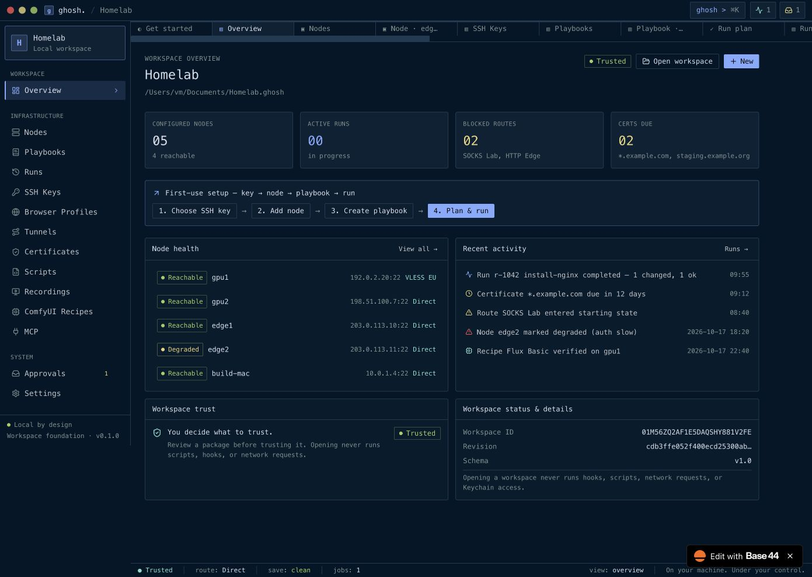
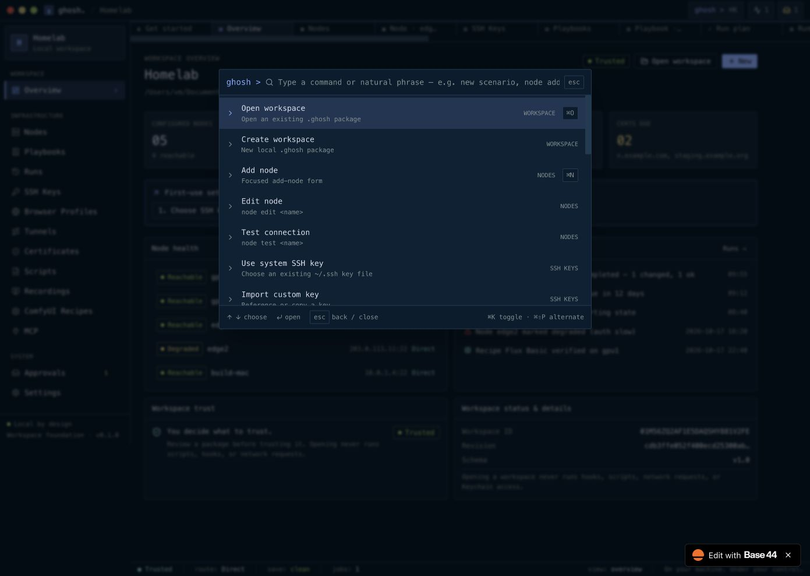
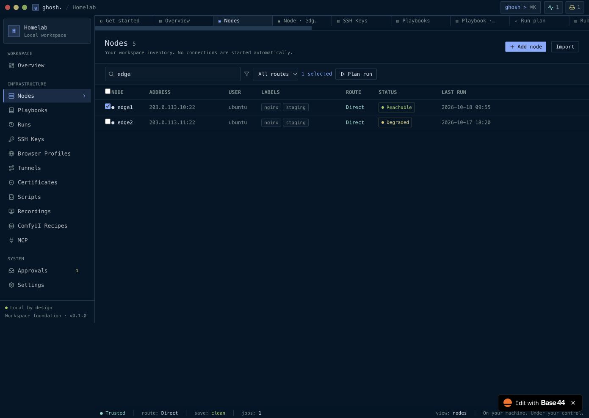
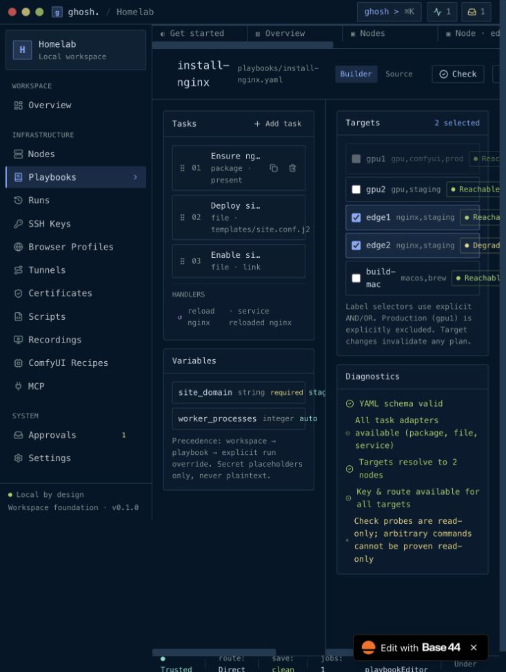
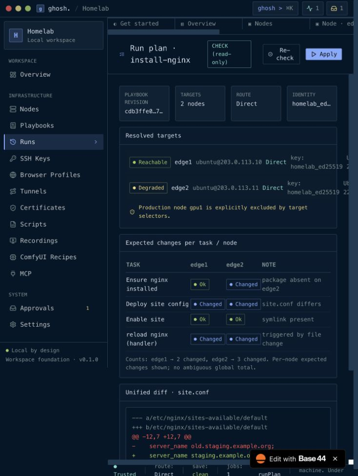
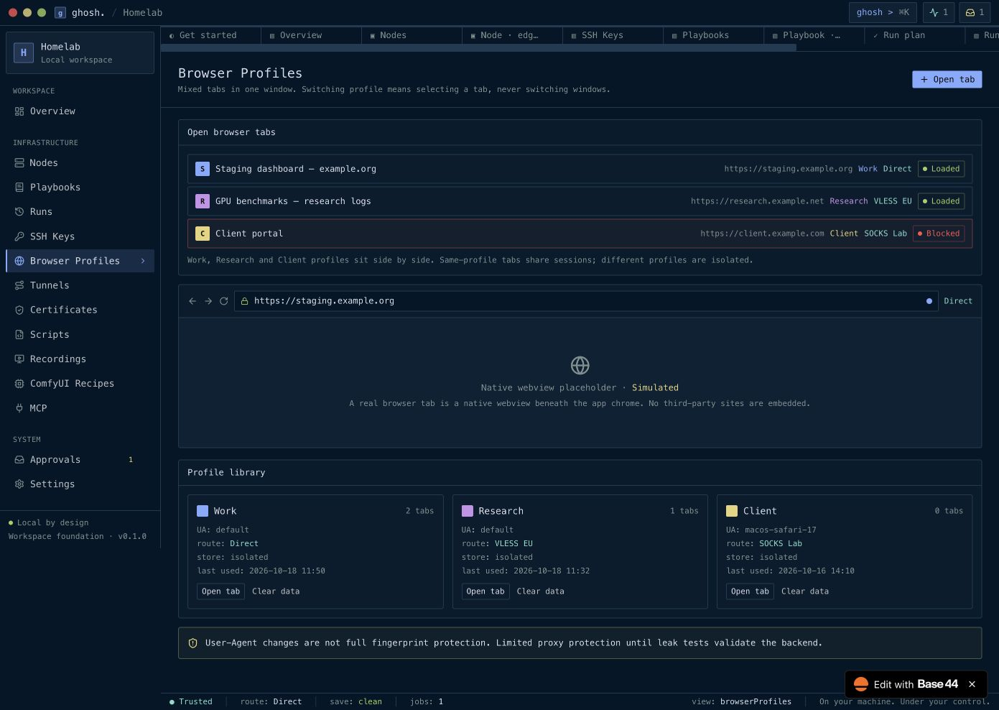

# Base44 reference application evidence

Inspected sequentially on 2026-10-18 through the requested in-app Browser.
Source: [Ghosh Herd OS reference](https://ghosh-herd-os.base44.app/).

Start with the [implementation plan](../../IMPLEMENTATION_PLAN_UI_FUNCTIONALITY.md)
and [interaction inventory](INTERACTION_INVENTORY.md). The inventory distinguishes
observed transitions, visible controls and placeholder behavior; screenshots alone
do not establish that an operation works.

These 33 original JPEG captures show the rendered Base44 prototype and its sample
Homelab data. They are separate from the [ten current native app captures](../README.md).
No native PTY, SSH connection, browser isolation or execution success is established
by these images. No local workspace, key or credential was uploaded. Forms were
inspected without creating workspaces, nodes or keys; actual grants and destructive
operations were not exercised. No Base44 project was edited or deployed.

Capture dimensions reflect the viewport at capture time, not target native window
requirements. The first 16 captures use a narrow viewport; later captures use the
expanded browser. Original bytes are preserved. See the [manifest](screenshots.json)
and [SHA-256 checksums](SHA256SUMS.txt), plus the [command catalog](commands.ax.txt)
and [settings observations](settings.ax.txt).

## Screenshots

| # | Screen | Dimensions |
| --- | --- | --- |
| 01 | [Welcome and recent workspaces](screenshots/01-welcome.jpg) | 734 × 975 |
| 02 | [Command popup and catalog](screenshots/02-command-popup.jpg) | 734 × 975 |
| 03 | [Workspace overview](screenshots/03-overview.jpg) | 734 × 975 |
| 04 | [Node inventory](screenshots/04-nodes.jpg) | 734 × 975 |
| 05 | [Add node form](screenshots/05-add-node.jpg) | 734 × 975 |
| 06 | [Node details](screenshots/06-node-detail.jpg) | 734 × 975 |
| 07 | [Open terminal form](screenshots/07-open-terminal.jpg) | 734 × 975 |
| 08 | [SSH key library](screenshots/08-ssh-keys.jpg) | 734 × 975 |
| 09 | [Import custom key form](screenshots/09-import-key.jpg) | 734 × 975 |
| 10 | [Playbook library](screenshots/10-playbooks.jpg) | 734 × 975 |
| 11 | [New playbook form](screenshots/11-new-playbook.jpg) | 734 × 975 |
| 12 | [Playbook builder](screenshots/12-playbook-builder.jpg) | 734 × 975 |
| 13 | [Playbook YAML source](screenshots/13-playbook-source.jpg) | 734 × 975 |
| 14 | [Run plan and review](screenshots/14-run-plan.jpg) | 734 × 975 |
| 15 | [Run history](screenshots/15-runs.jpg) | 734 × 975 |
| 16 | [Run monitor](screenshots/16-run-monitor.jpg) | 734 × 975 |
| 17 | [Browser profiles](screenshots/17-browser-profiles.jpg) | 1391 × 988 |
| 18 | [Tunnels and routes](screenshots/18-tunnels.jpg) | 1391 × 988 |
| 19 | [Certificates](screenshots/19-certificates.jpg) | 1391 × 988 |
| 20 | [Script library and capability review](screenshots/20-scripts.jpg) | 1391 × 988 |
| 21 | [Recordings](screenshots/21-recordings.jpg) | 1391 × 988 |
| 22 | [ComfyUI recipes](screenshots/22-recipes.jpg) | 1391 × 988 |
| 23 | [MCP server and clients](screenshots/23-mcp.jpg) | 1391 × 988 |
| 24 | [Approvals inbox](screenshots/24-approvals.jpg) | 1391 × 988 |
| 25 | [Appearance settings](screenshots/25-settings-appearance.jpg) | 1391 × 988 |
| 26 | [Keyboard shortcuts](screenshots/26-keyboard-shortcuts.jpg) | 1391 × 988 |
| 27 | [Overview at wide viewport](screenshots/27-overview-wide.jpg) | 1391 × 988 |
| 28 | [Create workspace form](screenshots/28-create-workspace.jpg) | 1391 × 988 |
| 29 | [Open workspace form](screenshots/29-open-workspace.jpg) | 1391 × 988 |
| 30 | [Command popup at wide viewport](screenshots/30-command-popup-wide.jpg) | 1391 × 988 |
| 31 | [Switch route form](screenshots/31-switch-route.jpg) | 1391 × 988 |
| 32 | [Node filtering and selection](screenshots/32-node-filter-selection.jpg) | 1391 × 988 |
| 33 | [Node inventory at wide viewport](screenshots/33-nodes-wide.jpg) | 1391 × 988 |

## Selected views

### Overview at wide viewport

### Command popup at wide viewport

### Node filtering and selection

### Playbook builder

### Run plan and review

### Browser profiles

